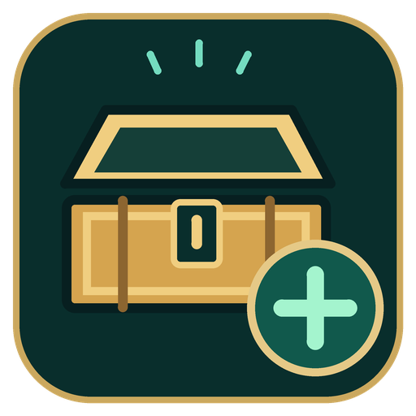

# TotK Mod Menu

Mod independente para o **[TotK Recomp](https://github.com/valentderah/totk-pc-recomp)**, com uma janela integrada ao menu do jogo para pesquisar itens por nome ou ID e solicitar sua criação perto do Link.

**Versão atual: `0.1.0-rc.1` — candidata a lançamento.** Algumas categorias e itens continuam experimentais.



O instalador, sua janela e o atalho usam um ícone próprio. O atalho abre pelo `pythonw.exe`, sem passar pelo prompt de comando.

> O recomp original é criado e mantido por **[valentderah](https://github.com/valentderah)**. Este projeto acrescenta o Mod Menu e seu instalador; não é uma versão oficial nem possui endosso do projeto original.

## O que o mod faz

- Adiciona uma janela de itens em **F1 > Cheats > Adicionar itens**.
- Permite pesquisar por nome e ID interno, com filtros por categoria e busca que desconsidera acentos.
- Mostra miniaturas reais extraídas localmente dos arquivos do próprio jogador.
- Oferece um catálogo que, na instalação usada nos testes, possui **1.393 entradas** e **1.382 miniaturas**. Itens sem miniatura usam um marcador.
- Inclui armas, arcos, escudos, armaduras, materiais, flechas, dispositivos Zonai em cápsulas e montados, alimentos e outras categorias.
- Cria objetos próximos do Link para recolher normalmente. Itens como armaduras são entregues por um baú que o jogador precisa abrir.
- Mantém os cheats já existentes na instalação quando seus arquivos correspondem aos patches compilados no cache.
- Disponibiliza um instalador gráfico que verifica a compatibilidade, gera o catálogo e as miniaturas e compila a versão com o mod.

**O pedido não adiciona diretamente um registro ao inventário:** o jogo cria o objeto ou o baú e o jogador o recolhe. Nem toda entrada do catálogo foi validada individualmente. Itens especiais, alimentos e outros conteúdos experimentais podem ter limitações.

“Flecha explosiva” também encontra a **Flor-bomba**, o material usado na combinação com flechas. Isso não representa um item separado de flecha explosiva. Dispositivos Zonai montados e versões em cápsulas aparecem em categorias distintas.

## Compatibilidade

| Componente | Versão suportada nesta candidata |
|---|---|
| Sistema | Windows x64 |
| Recomp | **0.3.1**, commit `ab1dee5bdb9089399b2000880eaa8f702a846f89` |
| Jogo | **1.4.3** |
| Build do jogo | `277178b7dba1b6d4949a84778d4abc58b31b34f5` |
| Configuração de CPU | **x86-64-v3** — requer os recursos dessa configuração, incluindo AVX2/FMA |
| Instalação prévia | Setup original e cache de compilação concluído e preservado |

Outras versões não são declaradas compatíveis. O instalador verifica o build do jogo, o runtime e o cache antes de compilar. Versões futuras do recomp ou do jogo precisam de adaptação e testes; não basta reutilizar os mesmos endereços.

## Instalação pelo executável

1. Instale o [recomp original](https://github.com/valentderah/totk-pc-recomp/releases/tag/v0.3.1) e conclua sua compilação usando seus próprios arquivos do jogo.
2. Mantenha a pasta do setup original, inclusive `python`, `llvm`, `runtime` e o cache em `temp`.
3. Baixe `TotK-ModMenu-Installer-0.1.0-rc.1.exe` na seção **[Releases](https://github.com/beerus-qAe/totk-mod-menu/releases)** deste projeto, quando o arquivo estiver publicado.
4. Salve e feche o jogo antes de instalar.
5. Abra o instalador, escolha a pasta do jogo instalado e confira a pasta do setup. O setup é localizado automaticamente quando possível; caso contrário, selecione-o.
6. Clique em **Instalar Mod Menu** e aguarde a geração das miniaturas e a compilação.
7. Use **Abrir Mod Menu** ou o atalho **TotK Mod Menu** criado na área de trabalho.

O instalador usa o Python e o compilador do setup original. Não exige Git, Python instalado no sistema ou downloads durante a instalação. Ele cria uma instalação separada, sem substituir o executável ou os saves originais.

## Como usar

1. Abra o jogo pelo atalho do Mod Menu e carregue seu save.
2. Pressione **F1** e entre em **Cheats > Adicionar itens**.
3. Pesquise um nome ou ID e escolha a categoria, se necessário.
4. Selecione o item e clique no botão de criação.
5. Volte ao jogo e recolha o objeto próximo do Link, ou abra o baú criado.

Os cheats aparecem como opções individuais no menu. Eles dependem dos arquivos locais e dos patches efetivamente compilados. **Esta candidata não acrescenta um cheat de dinheiro infinito nem distribui uma coleção de códigos de terceiros.**

## Saves e arquivos locais

A instalação e seu perfil ficam em:

```text
%LOCALAPPDATA%\TotKModMenu\installations
```

Na primeira instalação, o perfil é copiado da pasta do jogo selecionada. Ao reinstalar pelo instalador, o perfil da instalação bem-sucedida anterior é reaproveitado quando disponível. Saves de betas em outras pastas não são importados automaticamente.

Os registros do instalador ficam em:

```text
%LOCALAPPDATA%\TotKModMenu\logs
```

Uma tentativa que falha não substitui a referência para a instalação anterior que funcionava. Os arquivos da tentativa são mantidos para diagnóstico.

## Como funciona por dentro

O código do mod fica num módulo separado, com pontos pequenos de integração com o recomp:

1. **Catálogo e miniaturas:** as ferramentas leem o RomFS local para obter nomes, IDs e ícones. O atlas de miniaturas é gerado na máquina do jogador e integrado ao atlas de fontes da interface.
2. **Interface:** a janela usa Dear ImGui, junto ao menu nativo do recomp, com pesquisa, categorias, seleção e retorno de estado dos pedidos.
3. **Posição do Link:** um observador local de leitura identifica o Player em execução e publica uma indicação temporária de identidade. O backend verifica identidade e validade antes de usar a posição atual.
4. **Fila de criação:** a interface envia um pedido. Um hook recorrente na thread do jogo consome a fila usando um contexto de criação observado nessa mesma thread. A chamada não é executada pela thread de renderização.
5. **Entrega:** materiais e equipamentos compatíveis usam criação no mundo; categorias como armaduras usam baús. O jogo executa a coleta e o processamento normal de inventário.
6. **Compilação:** o instalador reaproveita objetos do cache compatível, recompila os trechos necessários com hooks, integra a interface numa cópia da biblioteca de runtime e gera um executável local.

Os arquivos C gerados pelo recomp não são editados manualmente. O módulo **ainda depende de um executável com integração própria**; não é uma API pública de plugins nem um mod que funciona apenas copiando uma pasta para qualquer versão.

## Código-fonte e desenvolvimento

Este repositório distribui o módulo e um patch para a versão suportada do recomp, preservando as licenças e os avisos de terceiros.

```text
apply.py                     Aplicação do pacote ao código upstream suportado
integration.patch            Integração com o menu original
package.json                 Versões e hashes do pacote de código
source/modmenu/              Interface, criação de itens, adaptadores e instalador
source/tools/                Ferramentas de compilação, catálogo e miniaturas
source/tests/                Verificações do módulo e do instalador
LICENSE                      Licença MIT preservada do código upstream
THIRD_PARTY_NOTICES.md        Créditos e licenças das dependências
```

Para aplicar ao checkout upstream correto, extraia ou clone este repositório numa pasta separada e execute:

```powershell
python apply.py --checkout "PASTA_DO_CODIGO_RECOMP" --check-only
python apply.py --checkout "PASTA_DO_CODIGO_RECOMP"
```

As instruções de compilação estão em **[source/modmenu/README.md](source/modmenu/README.md)**, e os detalhes do instalador em **[source/modmenu/installer/README.md](source/modmenu/installer/README.md)**. A criação do instalador exige os insumos de desenvolvimento descritos nesses documentos; o usuário final recebe esses componentes embutidos no executável.

## Estado dos testes e problemas conhecidos

- Testes em jogo confirmaram coleta de maçãs, armas, arco, escudo e armadura por baú nas betas. A espada também foi equipada, usada e preservada após salvar/carregar.
- A fila de pedidos repetidos foi testada nas betas e validada sem depender de consumir um item ou salvar para processar outro pedido.
- A candidata passou nos testes de serialização, catálogo, fila, interface, miniaturas, compatibilidade e aplicação do patch.
- O instalador passou por uma instalação completa isolada, e o executável gerado concluiu seu autoteste com **zero falhas**.
- Isso não significa que todos os itens ou todas as situações do jogo foram testados. A candidata ainda precisa de validação de gameplay após a instalação.

Para relatar um problema, informe a versão do mod, recomp e jogo, o nome/ID do item, a sequência de ações e o resultado observado. Verifique o conteúdo do log antes de publicá-lo, pois ele pode conter caminhos locais. Problemas específicos deste mod devem ser relatados aqui, sem sobrecarregar o projeto original.

## Créditos

**Crédito principal ao criador e mantenedor do recomp original: [Valiantsin Dzerakh — @valentderah](https://github.com/valentderah).**

O projeto **[valentderah/totk-pc-recomp](https://github.com/valentderah/totk-pc-recomp)** fornece a recompilação estática, runtime, renderização, serviços do jogo, menu e suporte a mods/cheats que tornam esta extensão possível. Todo esse trabalho permanece creditado ao projeto original e aos seus colaboradores.

- **Mod Menu, integração e testes:** [beerus-qAe](https://github.com/beerus-qAe), com assistência de desenvolvimento do Codex.
- **Interface:** Dear ImGui e integrações creditadas pelo recomp original.
- **Miniaturas locais:** Arm astcenc, Pillow e FontTools, com suas respectivas licenças.
- **Outros componentes upstream:** consulte [THIRD_PARTY_NOTICES.md](THIRD_PARTY_NOTICES.md) e os [créditos do recomp original](https://github.com/valentderah/totk-pc-recomp#credits).

## Licenças e arquivos do jogo

O código upstream mantém sua licença MIT e os avisos de copyright originais. Dependências de terceiros mantêm suas próprias licenças. Consulte [LICENSE](LICENSE) e [THIRD_PARTY_NOTICES.md](THIRD_PARTY_NOTICES.md).

O repositório e o instalador não distribuem ROMs, chaves, saves, miniaturas extraídas, catálogo extraído ou o executável recompilado do jogo. Esses resultados são produzidos localmente a partir dos arquivos do jogador e não fazem parte dos arquivos públicos.

The Legend of Zelda, Tears of the Kingdom e Nintendo Switch pertencem aos respectivos titulares. Este é um projeto independente de fãs, sem afiliação ou endosso da Nintendo ou do mantenedor do recomp original.
